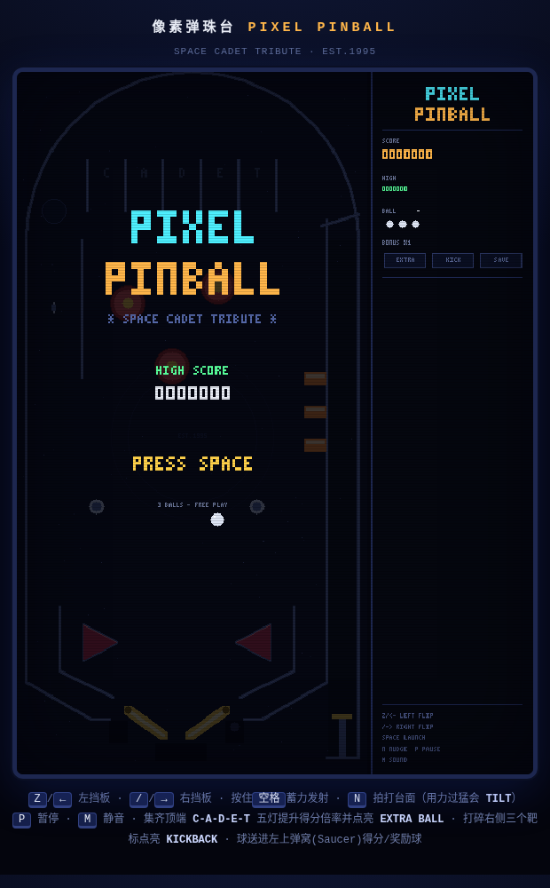
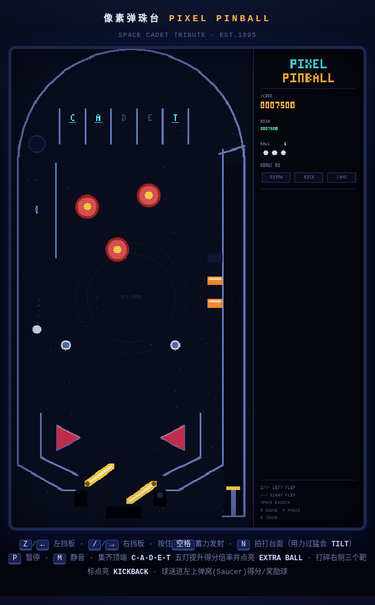

# 像素弹珠台 · PIXEL PINBALL

致敬 Windows 经典《三维弹球》(3D Pinball / Space Cadet) 的像素风网页弹珠台。
单文件、零依赖、离线可玩：直接用浏览器打开 `index.html` 即可。

## 操作

| 按键 | 功能 |
| --- | --- |
| `Z` / `←` | 左挡板 |
| `/` / `→` | 右挡板 |
| `空格`（按住） | 蓄力发射，松开发射 |
| `N` | 拍打台面（短暂内有冷却，拍太狠会 TILT） |
| `P` | 暂停 |
| `M` | 静音 |

触屏设备底部会出现三个按钮（左挡板 / 发射 / 右挡板）。

## 计分

| 事件 | 分值 |
| --- | --- |
| 弹射桩 Bumper | 100 × 倍率 |
| 弹板 Slingshot | 25 × 倍率 |
| 旋转器 Spinner | 100 × 倍率 |
| 橡胶柱 | 10 × 倍率 |
| 靶标（每枚） | 500 × 倍率 |
| 清空靶标组 | 5000 + 点亮 KICKBACK |
| C-A-D-E-T 灯位（每灯） | 500 × 倍率 |
| 集齐 CADET | 10000 + 倍率 +1 + 点亮 EXTRA BALL |
| 技巧球（发射后首个灯位） | 5000 |
| 弹窝 Saucer | 2500（亮 EXTRA BALL 时奖励一颗球） |

- 倍率由 CADET 灯位提升，最高 ×6，每颗球重置。
- KICKBACK：右下出球道口的回收器，球滑进出球道时向上弹回，一次性的。
- BALL SAVE：每颗球发射后 6 秒内流失会自动救回一次。
- TILT：拍打台面有热度，连拍 3 次挡板失效直到本球结束。
- 最高分存在浏览器 localStorage。

## 隐藏彩蛋

`index.html#demo` 进入自动演示模式（吸引画面上会自己打）。

## 开发/测试

端到端冒烟测试为本机开发工具（依赖本机 chromium），不随游戏包发布：
工作区根目录的 `pinball-smoke.js` 会在无头 Chromium 里实跑完整对局并断言。
`index.html#smoke` 为其自动化钩子，`#demo` 为自动演示彩蛋；两者不带 hash 时完全惰性。
`shots/` 内为无头 Chromium 截图（标题画面与实战画面）。
